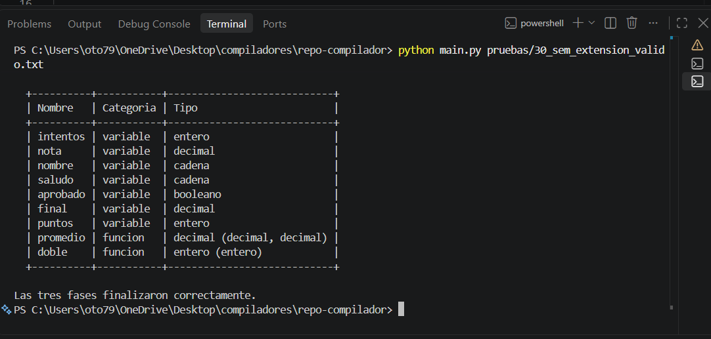
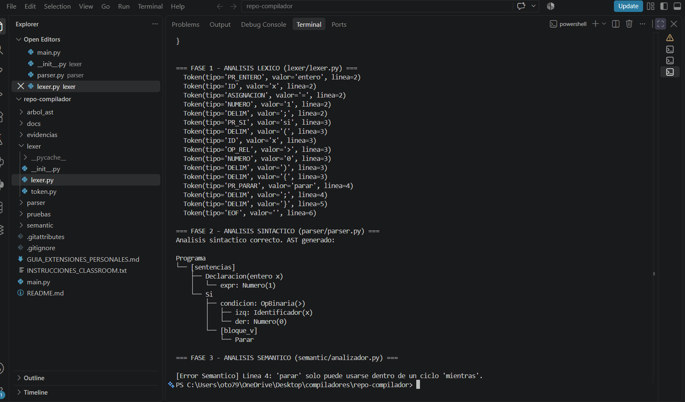
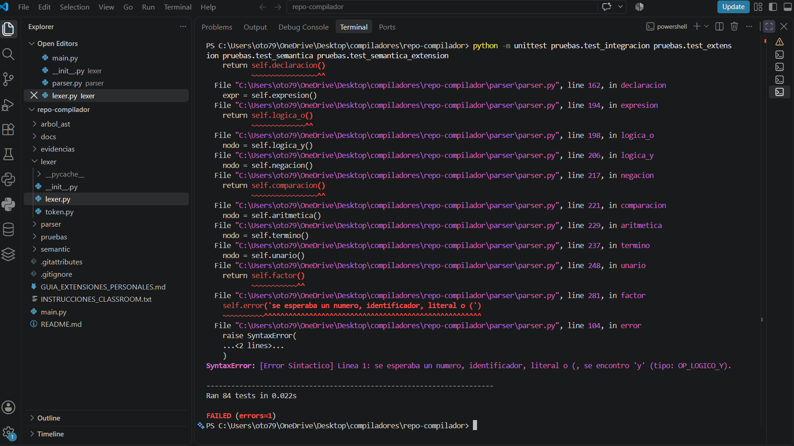

# MiCompilador — Lexer + Parser + AST + Análisis semántico

**Curso:** Compiladores — Universidad San Pablo de Guatemala
**Catedrático:** Ing. Carlos Isaac Arenas Guzmán
**Estudiante:** Celso Otoniel Hernández — Carné No. 2400455

Proyecto incremental de un compilador en Python. Cada entrega se construye sobre la anterior en este mismo repositorio:

| Entrega | Contenido | Documentación |
|---|---|---|
| 1 — Lexer | Tokens base + tokens de expansión del catálogo personal | [`docs/ENTREGA1_LEXER.md`](docs/ENTREGA1_LEXER.md) |
| 2 — Parser + AST | Parser descendente recursivo y extensión sintáctica | [`docs/ENTREGA2_PARSER.md`](docs/ENTREGA2_PARSER.md) |
| **3 — Análisis semántico** | Tabla de símbolos, tipos y reglas de la extensión | Este archivo |

Flujo completo: **código → tokens → AST → análisis semántico → tabla de símbolos**.
No se ejecuta el programa: **sin TAC, máquina virtual ni frontend**.

---

## Cómo ejecutar

Python 3.10 o superior, sin dependencias externas. Desde la raíz del proyecto:

```bash
python main.py                                          # pruebas/01_basico_valido.txt
python main.py pruebas/30_sem_extension_valido.txt      # mi extensión: válido + tabla de símbolos
python main.py pruebas/08_error_variable_no_declarada.txt
python main.py pruebas/11_error_tipo_incompatible.txt
python main.py --solo-lexer  pruebas/13_valido_relacionales.txt
python main.py --solo-parser pruebas/13_valido_relacionales.txt

python -m unittest pruebas.test_integracion pruebas.test_extension     # entregas 1 y 2
python -m unittest pruebas.test_semantica -v                           # semántica (docente)
python -m unittest pruebas.test_semantica_extension -v                 # semántica (mi extensión)
```

## Estructura

```text
├── main.py                    Fase 1 → Fase 2 → Fase 3 y tabla de símbolos
├── lexer/lexer.py             Fase 1: mi lexer (Entrega 1 + catálogo de expansión)
├── parser/parser.py           Fase 2: mi parser descendente recursivo
├── arbol_ast/nodos.py         Nodos del AST (base + extensión)
├── semantic/analizador.py     Fase 3: analizador semántico  ← ESTA ENTREGA
├── pruebas/                   Programas de prueba y tests automáticos
├── evidencias/entrega3/       Salidas de ejecución de esta entrega (.txt y .png)
└── docs/                      Documentación de las entregas anteriores
```

Se conservaron **mi lexer, parser y AST** de las entregas anteriores. Del proyecto base del docente se integraron `semantic/`, la Fase 3 de `main.py`, las pruebas `08` a `15` y `pruebas/test_semantica.py` (sin modificar). Mis pruebas de la Entrega 2 que tenían los números 08–11 se renumeraron a 20–23 para no chocar con las del docente.

Único cambio en las fases anteriores: los nodos `OpBinaria`, `OpUnaria`, `Imprimir`, `Si` y `Mientras` ahora guardan su **número de línea** (con `compare=False`, así las pruebas anteriores no cambian), para que los errores semánticos digan dónde ocurren.

---

## 1. Los métodos TODO

| Método | Qué valida | Error |
|---|---|---|
| `visitar_Declaracion()` | Nombre no repetido → analiza la expresión → tipo compatible → **recién entonces** registra en la tabla (así `entero x = x + 1;` detecta que `x` no existe). | `NameError` / `TypeError` |
| `visitar_Asignacion()` | La variable existe y el valor es compatible con su tipo. | `NameError` / `TypeError` |
| `visitar_Identificador()` | La variable existe; devuelve su tipo desde la tabla. | `NameError` |
| `visitar_OpBinaria()` | Resuelto por el docente; **ampliado** para mis tipos y operadores lógicos (ver sección 3). | `TypeError` |
| `visitar_Si()` | Condición booleana; recorre el bloque verdadero **y el bloque `sino`**. | `TypeError` |
| `visitar_Mientras()` | Condición booleana; recorre el bloque sin ejecutar el ciclo. | `TypeError` |

## 2. Reglas semánticas del lenguaje base

- Una variable se declara una sola vez; no se puede usar ni asignar sin declararla.
- `+ - * /` con dos enteros → `entero`.
- `== != < > <= >=` con dos enteros → `booleano`. Por eso `1 < x < 5` es error: `(1 < x)` ya es booleano.
- Declaraciones y asignaciones exigen el mismo tipo que la variable.
- Las condiciones de `si` y `mientras` deben ser `booleano`.
- Una sola tabla **global**, como pide la entrega.

---

## 3. Extensión personal: qué cambia en la semántica

La semántica recorre **nodos del AST**, no tokens. Para cada elemento de mi lenguaje:

| Token(s) | Nodo AST | Regla semántica | Prueba |
|---|---|---|---|
| `decimal`, `cadena`, `booleano` (tipos) | `Declaracion` | Nuevos tipos en la tabla. Un `entero` **cabe** en un `decimal`; un `decimal` **no** cabe en un `entero`. | `31_sem_error_decimal_en_entero` |
| `3.14`, `"hola"`, `verdadero/falso` | `Decimal`, `Cadena`, `Booleano` | Visitantes nuevos que devuelven `decimal`, `cadena`, `booleano`. | `30_sem_extension_valido` |
| `+ - * /` con decimales | `OpBinaria` | Si un operando es `decimal`, el resultado es `decimal`. | `test_entero_mas_decimal_es_decimal` |
| `+` con texto | `OpBinaria` | `cadena + cadena` → `cadena`. Otra combinación con texto es error. | `test_cadena_mas_numero_invalido` |
| `==`, `!=` | `OpBinaria` | También comparan dos `cadena` o dos `booleano`. | `test_igualdad_de_cadenas` |
| `y`, `o` | `OpBinaria` | Dos `booleano` → `booleano`. | `32_sem_error_logico_con_entero` |
| `no`, `-` unario | `OpUnaria` | `no` exige `booleano`; `-` exige número. | `37_sem_error_no_con_numero` |
| `sino`, `sino si` | `Si.bloque_f` | La rama falsa también se revisa (y su condición si es `sino si`). | `test_sino_se_revisa` |
| `entonces` | — (no cambia el AST) | **No requiere regla**: el parser lo acepta y no genera nodo. | — |
| `leer` | `Leer` | La variable debe existir. No se lee del teclado. | `36_sem_error_leer_no_declarada` |
| `parar`, `continuar` | `Parar`, `Continuar` | Solo dentro de un `mientras`. | `33_sem_error_parar_fuera_de_ciclo` |
| `funcion` | `Funcion` | Nombre no repetido, parámetros no repetidos. Se registra antes del cuerpo (permite recursión). Los parámetros solo existen dentro del cuerpo. | `test_funcion_duplicada` |
| `retornar` | `Retornar` | Solo dentro de una función; el valor debe coincidir con el tipo de retorno. | `35_sem_error_retorno_incorrecto` |
| llamada `f(...)` | `LlamadaFuncion` | La función existe; cantidad y tipos de argumentos correctos; devuelve su tipo de retorno. | `34_sem_error_argumentos_funcion` |
| `//`, `/* */` | — (el lexer los descarta) | **No requiere regla**: nunca llegan al AST. | `test_comentarios_no_llegan_a_la_semantica` |

Errores nuevos de contexto (`parar` fuera de un ciclo, `retornar` fuera de una función) se reportan como `ValueError`, que `main.py` ya maneja.

---

## 4. Tabla de símbolos

`self.tabla_simbolos = {nombre: tipo}` (la que piden las pruebas del docente) y, por mi extensión, `self.tabla_funciones = {nombre: (tipo_retorno, [tipos de parámetros])}`. `main.py` imprime ambas como diccionario y como tabla.

**Programa base** (`pruebas/01_basico_valido.txt`):

```text
Tabla de simbolos: {'edad': 'entero'}

  +--------+-----------+--------+
  | Nombre | Categoria | Tipo   |
  +--------+-----------+--------+
  | edad   | variable  | entero |
  +--------+-----------+--------+
```

**Mi extensión** (`pruebas/30_sem_extension_valido.txt`):

```text
  +----------+-----------+----------------------------+
  | Nombre   | Categoria | Tipo                       |
  +----------+-----------+----------------------------+
  | intentos | variable  | entero                     |
  | nota     | variable  | decimal                    |
  | nombre   | variable  | cadena                     |
  | saludo   | variable  | cadena                     |
  | aprobado | variable  | booleano                   |
  | final    | variable  | decimal                    |
  | puntos   | variable  | entero                     |
  | promedio | funcion   | decimal (decimal, decimal) |
  | doble    | funcion   | entero (entero)            |
  +----------+-----------+----------------------------+
```

Los parámetros `a`, `b` y `n` no aparecen porque solo existen dentro de su función.

---

## 5. Resultados de las pruebas

### Programas de prueba

| Archivo | Esperado | Resultado |
|---|---|---|
| `01_basico_valido` | Válido | Correcto · tabla `{'edad': 'entero'}` |
| `13_valido_relacionales` | Válido | Correcto · tabla `{'x': 'entero'}` |
| `06` / `08_error_variable_no_declarada` | Error semántico | `se asigna a 'x', que no ha sido declarada` |
| `09_error_variable_duplicada` | Error semántico | `Linea 2: la variable 'x' ya fue declarada` |
| `10_error_identificador_inexistente` | Error semántico (docente) | **Error sintáctico en mi lenguaje**: ver nota abajo |
| `16_error_identificador_inexistente_z` | Error semántico | `la variable 'z' no ha sido declarada` |
| `11_error_tipo_incompatible` | Error semántico | `no se puede inicializar 'x' (entero) con un valor de tipo 'booleano'` |
| `12_error_condicion_no_booleana` | Error semántico | `la condicion de 'si' debe ser booleana, se recibio 'entero'` |
| `14_error_asignacion_tipo` | Error semántico | `no se puede asignar un valor 'booleano' a 'x' (entero)` |
| `15_error_uso_antes_declarar` | Error semántico | `la variable 'x' no ha sido declarada` |
| `30_sem_extension_valido` | Válido (extensión) | Correcto · tabla con 7 variables y 2 funciones |
| `31` a `37` | Errores de la extensión | Cada uno con su mensaje y línea (ver `evidencias/entrega3/`) |

### Pruebas automáticas: 84 en total, 83 correctas

| Archivo | Pruebas | Resultado |
|---|---|---|
| `test_integracion.py` (docente, Entrega 2) | 14 | OK |
| `test_extension.py` (mía, Entrega 2) | 20 | OK |
| `test_semantica.py` (docente) | 18 | 17 OK · 1 explicada abajo |
| `test_semantica_extension.py` (mía) | 32 | OK |

> **Nota sobre `test_variable_inexistente_en_expresion` y `pruebas/10`.** Esa prueba usa `entero x = y + 5;`. En mi lenguaje, `y` es una **palabra reservada**: el operador lógico `OP_LOGICO_Y` de mi catálogo de tokens. Por eso mi compilador la detecta como **error sintáctico** (Fase 2) y nunca llega a la semántica, en lugar del `NameError` que espera la prueba del lenguaje base. No modifiqué la prueba del docente. La misma regla semántica sí se comprueba con otro nombre de variable en `pruebas/16_error_identificador_inexistente_z.txt` y en `test_variable_inexistente_con_otro_nombre`; además, `test_y_es_reservada_en_mi_lenguaje` documenta este comportamiento.

## 6. Evidencias

### Capturas en VS Code (Windows)

Tomadas en mi computadora, en [`evidencias/entrega3/capturas_vscode/`](evidencias/entrega3/capturas_vscode/):

**Tabla de símbolos de mi extensión** (`python main.py pruebas/30_sem_extension_valido.txt`):



**Error semántico de mi extensión: `parar` fuera de un ciclo** (las tres fases, `pruebas/33_sem_error_parar_fuera_de_ciclo.txt`):



**Pruebas automáticas: 84 ejecutadas**. El único error es la prueba con la variable `y`, explicada en la sección 5:



### Salidas completas de cada caso

En [`evidencias/entrega3/`](evidencias/entrega3/) está la salida de cada caso en `.txt` (completa) y `.png`:

1. `01_valido_tabla_simbolos` y `02_valido_relacionales`: programas válidos y su tabla.
2. `03` a `06`: errores semánticos del lenguaje base.
3. `07_extension_valida_tabla`: programa válido con mi extensión y su tabla de símbolos.
4. `08` a `11`: errores semánticos de mi extensión.
5. `12_pruebas_unitarias`: resumen de las 84 pruebas.
