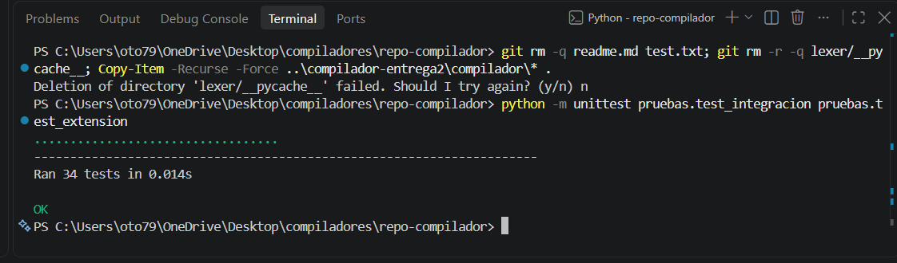
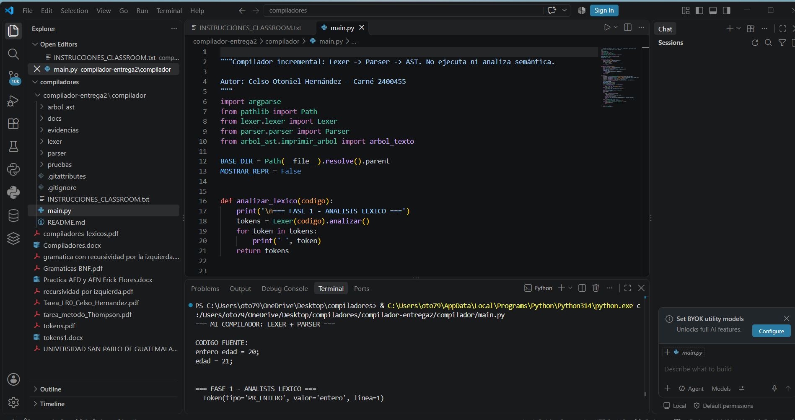

# MiCompilador — Lexer + Parser + AST

**Curso:** Compiladores — Universidad San Pablo de Guatemala
**Catedrático:** Ing. Carlos Isaac Arenas Guzmán
**Estudiante:** Celso Otoniel Hernández — Carné No. 2400455

Proyecto incremental de un compilador en Python. Cada entrega se construye sobre la anterior en este mismo repositorio:

| Entrega | Contenido | Documentación |
|---|---|---|
| 1 — Lexer | Tokens base (`PR_SI`, `PR_MIENTRAS`, `PR_IMPRIMIR`, `OP_REL`) + tokens de expansión del catálogo personal | [`docs/ENTREGA1_LEXER.md`](docs/ENTREGA1_LEXER.md) |
| **2 — Lexer + Parser + AST** | Parser descendente recursivo, AST y **extensión sintáctica personal** | Este archivo |
| 3 — Semántica | Pendiente | — |

> Esta entrega **no** incluye análisis semántico ni ejecución de código.

---

## Cómo ejecutar

Python 3.10 o superior, sin dependencias externas. Desde la raíz del proyecto:

```bash
python main.py                                       # prueba por defecto (01_basico_valido.txt)
python main.py pruebas/08_programa_valido_completo.txt
python main.py pruebas/04_error_falta_punto_coma.txt
python main.py pruebas/07_extension_personal.txt
python main.py --solo-lexer pruebas/07_extension_personal.txt
python main.py --repr pruebas/02_expresiones.txt     # además muestra el AST con repr()

python -m unittest pruebas.test_integracion -v       # pruebas del docente (14)
python -m unittest pruebas.test_extension -v         # pruebas de la extensión (20)
```

## Estructura

```text
├── main.py                    Fase 1 (lexer) → Fase 2 (parser) → muestra el AST
├── lexer/
│   ├── token.py               Token(tipo, valor, linea)
│   └── lexer.py               Lexer propio de la Entrega 1 + tokens de expansión
├── parser/
│   └── parser.py              TODO 1-12 completados + Etapa D (extensión)
├── arbol_ast/
│   ├── nodos.py               Nodos base + nodos de la extensión
│   └── imprimir_arbol.py      Muestra el AST como árbol de texto
├── pruebas/                   Programas de prueba y tests (ver tabla abajo)
├── evidencias/                Salidas de ejecución (.txt y .png)
└── docs/ENTREGA1_LEXER.md     Enunciado de la Entrega 1
```

---

## 1. Lexer conservado (Entrega 1 + tokens adicionales)

Se conserva el lexer propio de la Entrega 1 (`PR_ENTERO`, `PR_SI`, `PR_MIENTRAS`, `PR_IMPRIMIR`, `NUMERO`, `ID`, `OP_REL`, `OP_ARIT`, `ASIGNACION`, `DELIM`) y se incorporan **todos** los tokens de expansión propuestos en la tarea *Definición y Expansión de Tokens Léxicos* (`tokens_catalogo.pdf`):

| Token | Lexema / patrón |
|---|---|
| `PR_CADENA`, `PR_DECIMAL`, `PR_BOOLEANO` | `cadena`, `decimal`, `booleano` |
| `PR_SINO`, `PR_ENTONCES` | `sino`, `entonces` |
| `PR_PARAR`, `PR_CONTINUAR` | `parar`, `continuar` |
| `PR_FUNCION`, `PR_RETORNAR` | `funcion`, `retornar` |
| `PR_LEER` | `leer` |
| `CADENA_LITERAL` | `"([^"]*)"` → `"Hola Mundo"` |
| `NUMERO_DECIMAL` | `[0-9]+\.[0-9]+` → `3.14` |
| `BOOLEANO` | `verdadero`, `falso` |
| `OP_LOGICO_Y`, `OP_LOGICO_O`, `OP_LOGICO_NO` | `y`, `o`, `no` |
| `COMENTARIO_LINEA` | `//...` (se descarta) |
| `COMENTARIO_BLOQUE` | `/* ... */` (se descarta, conserva el conteo de líneas) |

Decisiones de orden en el esquema: comentarios antes de `OP_ARIT` (por la `/`), `NUMERO_DECIMAL` antes de `NUMERO`, palabras reservadas antes de `ID` (con `\b` para que `nota` no se parta en `no` + `ta`), y `OP_REL` antes de `ASIGNACION`.

Único agregado fuera del catálogo: la **coma `,`** dentro de `DELIM`, necesaria para separar parámetros y argumentos de funciones.

---

## 2. Gramática implementada

Parser **descendente recursivo**, un método por no terminal. En **negrita**, las reglas agregadas por la extensión personal.

```text
programa     → sentencia* EOF

sentencia    → declaracion | asignacion | imprimir | si | mientras
             | leer | parar | continuar | funcion | retornar | llamada ';'      ← EXT

declaracion  → tipo ID '=' expresion ';'
tipo         → 'entero' | 'decimal' | 'cadena' | 'booleano'                    ← EXT
asignacion   → ID '=' expresion ';'
imprimir     → 'imprimir' '(' expresion ')' ';'
si           → 'si' '(' expresion ')' ['entonces'] bloque ['sino' (si | bloque)] ← EXT
mientras     → 'mientras' '(' expresion ')' bloque
bloque       → '{' sentencia* '}'

leer         → 'leer' ID ';'                                                   ← EXT
parar        → 'parar' ';'                                                     ← EXT
continuar    → 'continuar' ';'                                                 ← EXT
funcion      → 'funcion' tipo ID '(' [parametro (',' parametro)*] ')' bloque   ← EXT
parametro    → tipo ID                                                         ← EXT
retornar     → 'retornar' [expresion] ';'                                      ← EXT
llamada      → ID '(' [expresion (',' expresion)*] ')'                         ← EXT

expresion    → logica_o
logica_o     → logica_y ('o' logica_y)*                                        ← EXT
logica_y     → negacion ('y' negacion)*                                        ← EXT
negacion     → 'no' negacion | comparacion                                     ← EXT
comparacion  → aritmetica (OP_REL aritmetica)*
aritmetica   → termino (('+' | '-') termino)*
termino      → unario (('*' | '/') unario)*
unario       → '-' unario | factor                                             ← EXT
factor       → NUMERO | ID | '(' expresion ')'
             | NUMERO_DECIMAL | CADENA_LITERAL | BOOLEANO | llamada            ← EXT
```

**Precedencia** (de menor a mayor): `o` < `y` < `no` < `OP_REL` < `+ -` < `* /` < `-` unario < factor. Los operadores binarios son asociativos por la izquierda (`1 - 2 - 3` = `(1 - 2) - 3`).

**Decisión con `ID`:** cuando una sentencia empieza con `ID`, el parser mira un token adelante (`siguiente()`): si es `(` es una llamada a función; si no, es una asignación. Con eso la gramática sigue siendo LL(1) sin retroceso.

---

## 3. Extensión personal: qué cambió en el parser por cada token

| Token del lexer | ¿Cambia el parser? | Cambio / justificación |
|---|---|---|
| `PR_DECIMAL`, `PR_CADENA`, `PR_BOOLEANO` | Sí | Se agregan a `TIPOS_DATO`; `sentencia()` y `declaracion()` los aceptan igual que `entero`. |
| `NUMERO_DECIMAL`, `CADENA_LITERAL`, `BOOLEANO` | Sí | Nuevas opciones en `factor()`; nodos `Decimal`, `Cadena`, `Booleano`. |
| `PR_SINO` | Sí | Rama opcional en `sentencia_si()`; se agregó `bloque_f` al nodo `Si`. Soporta `sino si` encadenado. Un `sino` suelto es error sintáctico. |
| `PR_ENTONCES` | Sí (opcional) | Se acepta de forma opcional después de la condición del `si`. Produce el mismo AST con o sin `entonces`, porque no aporta información al árbol. |
| `OP_LOGICO_Y`, `OP_LOGICO_O`, `OP_LOGICO_NO` | Sí | Tres niveles nuevos de precedencia sobre `comparacion`; `no` genera `OpUnaria`. |
| `PR_LEER` | Sí | Nueva sentencia `leer ID ;` → nodo `Leer`. |
| `PR_PARAR`, `PR_CONTINUAR` | Sí | Nuevas sentencias → nodos `Parar` y `Continuar`. Validar que estén dentro de un `mientras` es trabajo de la fase **semántica**, no del parser. |
| `PR_FUNCION`, `PR_RETORNAR` | Sí | Definición de función con parámetros tipados, `retornar` con valor opcional y llamadas como expresión o sentencia. Nodos `Funcion`, `Parametro`, `Retornar`, `LlamadaFuncion`. |
| `-` unario (`OP_ARIT`) | Sí | Nivel `unario()` para aceptar `-5` o `-(a + b)`. |
| `COMENTARIO_LINEA`, `COMENTARIO_BLOQUE` | **No** | El lexer los descarta y nunca llegan al parser, así que no requieren reglas. |
| `OP_REL` con `<=`, `>=`, `!=` | **No** | La regla por categoría `OP_REL` en `comparacion()` ya los cubre; está verificado en las pruebas. |

---

## 4. Pruebas

| Archivo | Tipo | Resultado esperado |
|---|---|---|
| `01_basico_valido.txt` | Válido | AST con declaración y asignación |
| `02_expresiones.txt` | Válido | `5 + 3 * 2` con la multiplicación como rama derecha |
| `03_control.txt` | Válido | `mientras` y `si` con bloques |
| `04_error_falta_punto_coma.txt` | **Error sintáctico** | `se esperaba ';'` en línea 2 |
| `05_error_declaracion.txt` | **Error sintáctico** | `se esperaba 'ID'` |
| `06_solo_error_semantico_futuro.txt` | Válido | Sintácticamente correcto (la semántica lo revisará después) |
| `07_extension_personal.txt` | **Extensión — válido** | Usa todos los tokens adicionales |
| `08_programa_valido_completo.txt` | Válido | Programa de la Entrega 1 + menos unario |
| `09_error_extension_sino_sin_si.txt` | **Extensión — error** | `'sino' sin un 'si' previo` |
| `10_error_extension_funcion.txt` | **Extensión — error** | Falta coma entre parámetros |
| `11_error_bloque_sin_cerrar.txt` | **Error sintáctico** | `se esperaba '}'` indicando la línea donde se abrió |

Pruebas automáticas: **34 en total, todas pasan** (14 del docente en `test_integracion.py`, sin modificar, y 20 propias en `test_extension.py`).

## 5. Evidencias de ejecución

### Capturas tomadas en VS Code (Windows)

Carpeta [`evidencias/capturas_vscode/`](evidencias/capturas_vscode/):

| # | Captura | Qué demuestra |
|---|---|---|
| 1 | `01_ejecucion_main_vscode.png` | `main.py` ejecutándose en VS Code: código fuente y Fase 1 (lexer) |
| 2 | `02_pruebas_34_ok.png` | Las 34 pruebas (docente + extensión) pasan: `Ran 34 tests ... OK` |
| 3 | `03_git_clone.png` | Clonado del repositorio con el historial de la Entrega 1 |
| 4 | `04_git_commit.png` | Commit de la Entrega 2 con los archivos nuevos |
| 5 | `05_git_push.png` | Publicación en GitHub (`main -> main`) |

**Pruebas automáticas (34 OK):**



**Ejecución en VS Code:**



### Salidas completas de cada caso

Para ver el AST completo de cada programa, en [`evidencias/`](evidencias/) está la salida íntegra de la consola en `.txt` (y su imagen `.png`):

1. `01_programa_valido` — programa válido y su AST
2. `02_error_sintactico` — detección de error sintáctico (falta `;`)
3. `03_extension_personal` — programa que usa la extensión personal
4. `04_error_extension` — error sintáctico con la extensión (`sino` sin `si`)
5. `05_pruebas_unitarias` — detalle de las 34 pruebas

Se pueden reproducir con los comandos de la sección *Cómo ejecutar*.

## Sintaxis vs. semántica

`entero x = ;` tiene tokens válidos pero es **sintácticamente inválido**. `x = 10;` es **sintácticamente válido** aunque `x` no esté declarada; eso, junto con tipos, `parar` fuera de un ciclo o llamar a funciones inexistentes, corresponde a la fase semántica de la siguiente entrega.
